<div align="center">

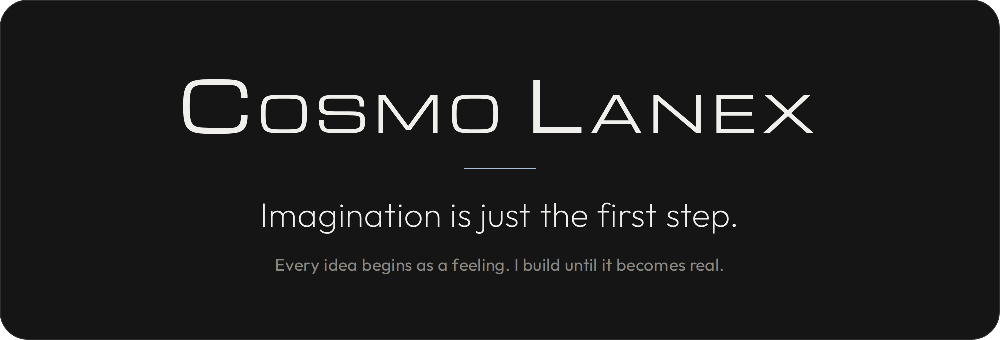

<br>

<a href="https://www.youtube.com/@CosmoLanex"></a>
<a href="https://x.com/CosmoLanex"></a>
<a href="https://github.com/CosmoLanex">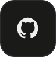</a>
<a href="#drop-crypto"></a>

</div>

<br>

<details open>
<summary><b>Company</b> &nbsp;|&nbsp; The companies I&rsquo;ve built.</summary>
<br>
<div align="center">

<a href="https://nukrax.com/">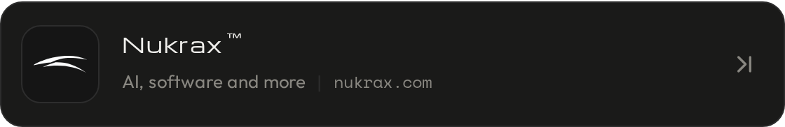</a>

<a href="https://nukrax.shop/">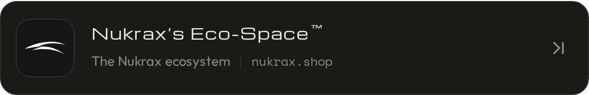</a>

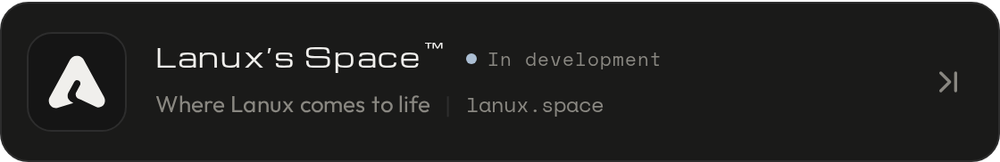

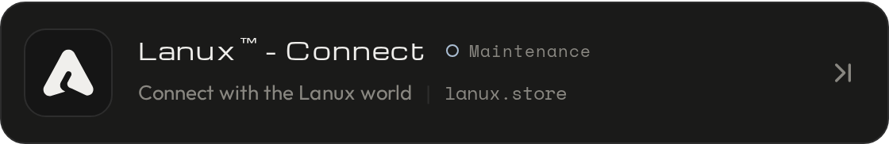

</div>


<br>

## Drop Crypto

If my work made you feel something, you can send a little back. Pick a currency, scan the code or copy the address. The codes never expire.

<details>
<summary><b>Bitcoin</b> (BTC)</summary>
<br>


```
bc1qk2t0uvv4j7kfzpn8mvt8uxtt6cq0dnkp4dgeas
```
</details>

<details>
<summary><b>Solana</b> (SOL)</summary>
<br>
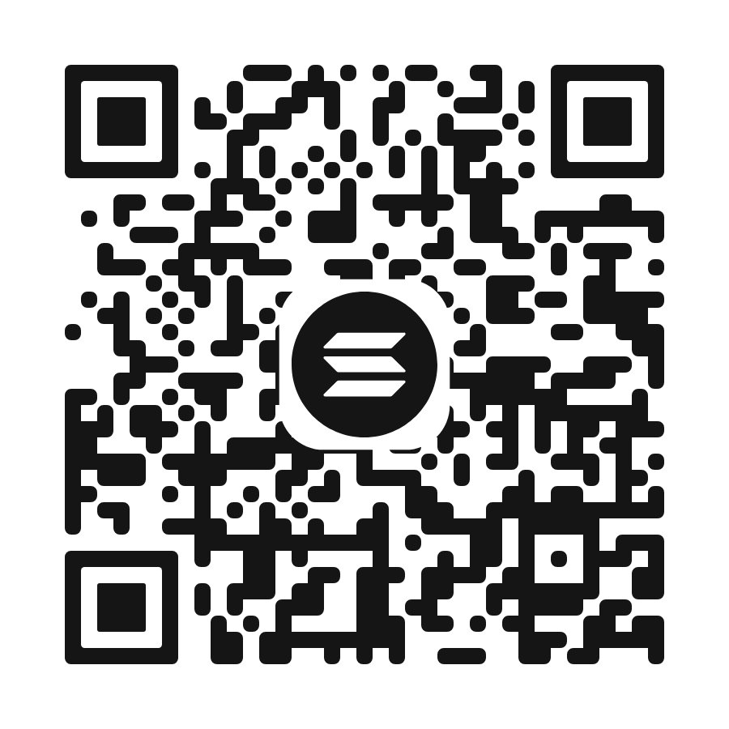

```
Dp5YavkzJ5Chtq6rFKnim7WR3xXksJVKg5iTKZjZZH7W
```
</details>

<details>
<summary><b>XRP</b> (XRP)</summary>
<br>
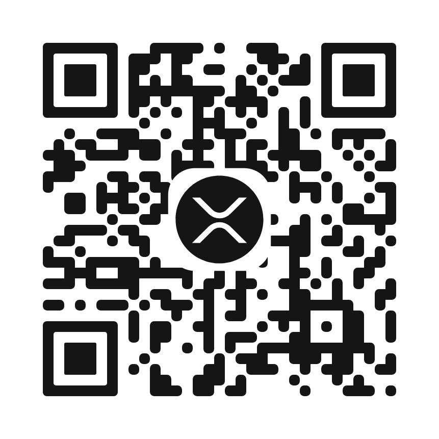

```
rU1HVivNon69SYwPkEVJXGt12yQKJtguqJ
```
</details>

<br>

## Get Nukrax updates

<div align="center">

<a href="https://nukrax.com/subscribe/">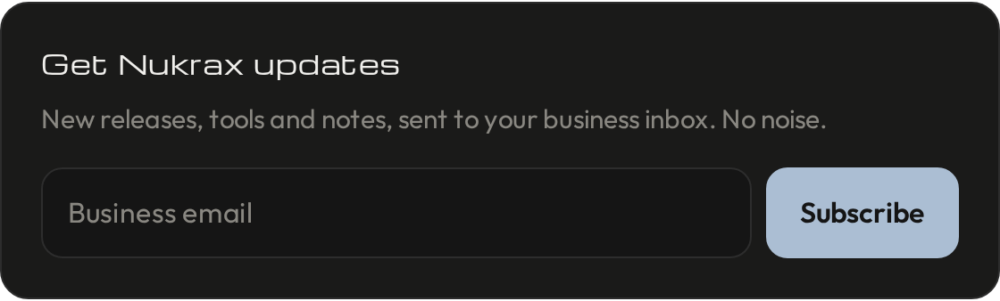</a>

</div>

<br>

## Contact

Send your work, ask a question, or just say hello.

<div align="center">

<a href="mailto:contact@nukrax.com">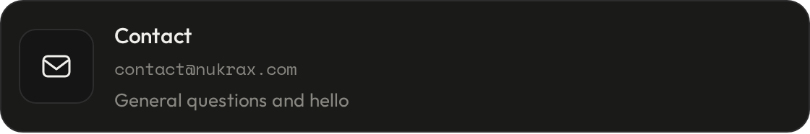</a>

<a href="mailto:work@nukrax.com?subject=Work%20submission">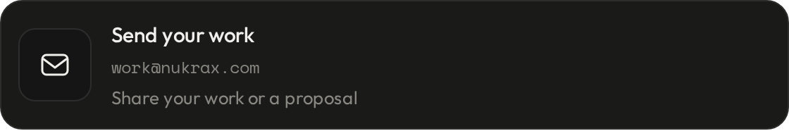</a>

<a href="mailto:enquiry@nukrax.com?subject=Enquiry">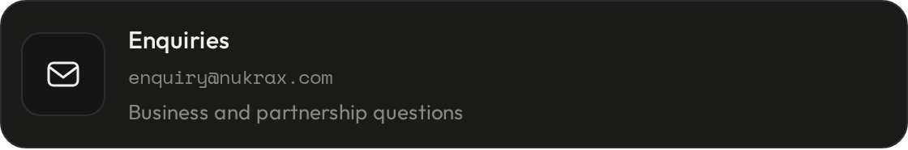</a>

</div>

<br>

## About

**Imagination is just the first step.**

Every build starts as a feeling: a quiet curiosity, a restless idea, the thrill of seeing something that did not exist yesterday. I follow that feeling until it turns into something real. There is fear in starting and joy in finishing. Both are welcome here.

**What I build**

* **Nukrax&trade;** is a tech company that develops AI, software and more. It created Lanux, its own AI.
* **Lanux&trade;** is the AI created by Nukrax, shaped one careful step at a time.

**What moves me**

* **Curiosity.** Every project begins with a question I cannot stop asking.
* **Courage.** Starting is the hardest part. I start anyway, even when I am afraid.
* **Gratitude.** Every visit, every subscriber and every message makes the work feel real.

<br>

<div align="center">

*Every idea begins as a feeling. I build until it becomes real.*

</div>
